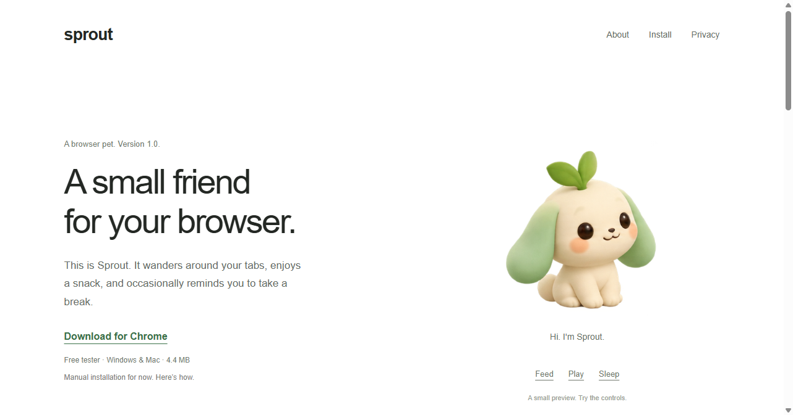

# Sprout

<p align="center">
  
</p>

A little woodland companion for your browser and Windows desktop. Sprout wanders, can be dragged around, and responds to food, play, affection, baths, and sleep.

**Website:** [sprout.dhakshini.studio](https://sprout.dhakshini.studio) · **[Download the Chrome tester](https://sprout.dhakshini.studio/downloads/Sprout-Chrome-1.0.0.zip)**

The Chrome tester is available by manual installation. A Chrome Web Store listing and standalone desktop installer are not available yet.

<p align="center">
  <a href="https://sprout.dhakshini.studio"></a>
</p>

## About

Sprout is a small woodland pet for your browser and Windows desktop. It wanders around the screen, can be dragged anywhere, and responds to care:

- 🍓 **Feed** and 🎾 **play** with a ball
- 🛁 **Bathe** and 😴 **sleep / wake** on your schedule
- 💗 **Affection** and progress that you can follow over time
- 🔔 **Check-ins** every 5 or 10 minutes, with optional voice
- 👫 **Connect** with a friend in a shared room and pass control back and forth

It is available as a Chrome extension tester (Windows and Mac, Chrome 116+) and a source-run Electron desktop pet. Sprout is the only pet: wardrobe, accessories, name badges, and emoji effects have been removed.

**Stack:** React, TypeScript, Zustand, Vite, Tailwind, Electron, and a Node WebSocket room service.

## Current status

- **Hover hearts:** keep your cursor on Sprout for a continuous flow of three soft red 3D hearts in a vertical zigzag. Moving away stops new hearts; existing hearts gently fade from top to bottom. Available on the desktop and browser pet, with reduced-motion support.
- **Care:** feeding, play with an animated graphical ball, bathing, sleep/wake, affection, progress, and a saved 80-220 px size control.
- **Companion:** local check-ins every 5 or 10 minutes, optional device-local voice, and an optional focus topic. These are prewritten messages, not AI conversation.
- **Connect:** two-person rooms, room codes, shared pet movement/actions, control requests, handoff, and leaving. A single controller is enforced by the server.
- **Platforms:** the Chrome extension can be installed on Windows and Mac with Chrome 116+. Native desktop behavior has been tested on Windows; a Mac desktop build has not been packaged or verified.
- **Website:** the download website is deployed on Vercel at [sprout.dhakshini.studio](https://sprout.dhakshini.studio), with verified DNS and HTTPS. Its interactive Play preview uses eight preloaded PNG frames instead of a GIF.
- **Desktop check-ins:** dismissible speech bubbles above Sprout, replacing Windows notifications. Bubbles follow the pet and close after 20 seconds.
- **Room service:** Render configuration and instructions are prepared, but the public room service is **not deployed**. Local connection and two-window interface tests pass.
- **Personalization:** text chat, conversation memory, and on-device AI are planned, not implemented. Check-ins remain prewritten.
- **Latest extension fix:** removed the invalid IPv6 localhost address from the security policy. The corrected tester ZIP is available on the website.

## Install the downloaded tester

1. [Download the ZIP](https://sprout.dhakshini.studio/downloads/Sprout-Chrome-1.0.0.zip) and extract it completely.
2. Open the extracted `Sprout-Chrome-1.0.0` folder, then its inner **Sprout-Chrome** folder. This inner folder contains `manifest.json`.
3. Open `chrome://extensions` in Chrome and enable **Developer mode**.
4. Choose **Load unpacked** and select that inner **Sprout-Chrome** folder.
5. Pin Sprout, open a regular webpage, refresh it, and close the toolbar popup to see the floating pet.

The extension appears inside webpages, not over the Windows desktop or other apps. The desktop companion below is a separate application.

### Updating or troubleshooting

- **Update:** download and extract the latest ZIP, replace the files in the folder Chrome already loads, click Sprout’s **Reload** button in `chrome://extensions`, and refresh your webpage tabs. Manual tester installations do not update automatically.
- **“Manifest file is missing or unreadable”:** choose the inner `Sprout-Chrome` folder containing `manifest.json`, rather than the outer extraction folder or the ZIP itself.
- **Only the toolbar popup appears:** close it and refresh a regular webpage. Chrome’s New Tab page, settings, extension management, and Web Store do not allow the floating pet. Check that the popup says **Hide pet**; if it says **Show pet**, click it.
- **Invalid `connect-src` warning mentioning IPv6 localhost:** download the corrected build, replace the loaded files, reload the extension, and clear the old errors. Chrome ignored that address; the warning alone does not establish why a pet is missing.
- **Still missing:** check Sprout’s **Errors** entry in `chrome://extensions` after reloading and refreshing. Verify Chrome has allowed the extension access to the page.

## Develop locally

Use Node.js 22 or later and npm. Python 3 is needed only to generate the sharing ZIPs.

```powershell
npm ci
npm run dev
```

Open the Vite URL for the website. The interface has four tabs: **Care**, **Companion**, **Connect**, and **Progress**. Choose **Try a little wander** to preview the floating webpage pet.

### Build the Chrome extension from source

```powershell
npm run build
```

1. Open `chrome://extensions` and enable **Developer mode**.
2. Choose **Load unpacked** and select this project's `dist` folder.
3. Pin the extension, then refresh existing webpage tabs.

Click the floating pet for care actions; drag it to move it. The bottom-right control pauses wandering or opens the care drawer. The popup provides quick care and an **Open care & companion** button.

Chrome blocks content scripts on internal pages, the Chrome Web Store, and other protected pages. File URLs require Chrome's separate file-access setting. After rebuilding, reload the extension and refresh existing tabs to replace old scripts and artwork.

### Run the Windows desktop companion

After `npm ci`, double-click `Start-Sprout.cmd`, or run:

```powershell
npm run desktop
```

This builds and launches a transparent, always-on-top pet. After building once, `npm run desktop:start` launches it directly. If Electron's runtime is missing, the launcher downloads it from the official release source; those downloads must be reachable.

- Hover to pause wandering; drag the pet to reposition it or move it to another monitor.
- Click the pet to open care controls. Right-click it or its tray icon for care, pause/resume, hide/show, monitor recovery, and quit.
- Transparent space outside the pet passes mouse clicks to the app below; the pet's rectangular hit area stays interactive.
- The window resizes with the pet and stays within the monitor's work area, avoiding the taskbar.
- No startup entry is installed. Exclusive full-screen apps, secure Windows screens, and other virtual desktops may cover the pet.

The desktop shell uses a sandboxed renderer, context isolation, restricted IPC, and no Node access in the page. Desktop state is saved locally in Electron's user-data directory and shared between its windows. It is separate from Chrome extension state.

## Check-ins and privacy

The **Companion** tab provides 5/10-minute intervals, pause, a manual test, a focus topic, and optional voice. Scheduled check-ins pause when the pet sleeps or is hidden, when a webpage is inactive, and during a shared session. Desktop check-ins appear in a speech bubble above Sprout and dismiss after 20 seconds. Voice uses an available English device-local voice and otherwise stays text-only.

Visible-page-heading context is **off by default**. If enabled in the extension, it samples at most six visible H1/H2 headings (800 characters total), processes them in memory on-device, and chooses a matching prewritten message. It does not read form inputs, take screenshots, execute page instructions, store raw headings, or upload page text. Focus topics and check-ins are not shared with friends.

The desktop app cannot currently read other apps. Full screen-aware AI conversation still needs a screen/window selection flow and a connected vision/chat model. No screen capture, AI backend, or AI API key is configured.

## Connect with a friend

```powershell
npm run server
```

The local service listens at `ws://127.0.0.1:8787/rooms`; its health endpoint is `http://127.0.0.1:8787/health`. Loopback works only on the same computer.

Open **Connect** on both clients, enter the same service address, then create a room on one and join with the code on the other. The viewer can request control; the current controller chooses **Pass control to friend**. Closing an extension popup or desktop care window does not end its background connection. Website connections last while the page stays open.

For separate laptops/networks, deploy the service and use a public `wss://` address. See [CONNECTION.md](CONNECTION.md) for Render steps, container deployment, operating limits, and protocol details. `render.yaml` selects a Free room service, but **that service is not deployed yet**. The download website is hosted separately on Vercel. Set `VITE_ROOM_SERVICE_URL` before building to prefill a deployed address.

Rooms contain two people, expire after two hours, and disappear on server restart. The remaining participant gains control when the controller disconnects. Only normalized pet coordinates, size, animation, and care stats are relayed; screen contents, URLs, microphone audio, and OS control are not shared. TLS protects the connection to the selected service; this is not end-to-end encryption beyond that service.

## Share a build

```powershell
npm run build
python scripts/package-share.py
```

This generates two archives in the ignored `release/` directory:

- `Sprout-Chrome-1.0.0.zip`: the built extension plus installation instructions, for Chrome on Mac or Windows.
- `Sprout-Room-Service-1.0.0.zip`: minimal service sources, dependency lockfile, Render configuration, and connection instructions.

The archives exclude profiles, local state, Git data, dependencies, and quarantined files. The extension ZIP does not include a hosted service or a native Mac desktop application.

## Download website

The marketing and download site lives in [`website/`](website/README-SPROUT.md), separately from the Vite care application. It uses Next.js static export, Arial typography, plain links, and an interactive Sprout preview.

- **Production:** [https://sprout.dhakshini.studio](https://sprout.dhakshini.studio)
- **Host/project:** Vercel, `dhakshini/sprout`.
- **DNS:** Name.com CNAME host `sprout` points to `843c3acda7a8cbb3.vercel-dns-017.com`.
- **Build:** run `npm run build:vercel` inside `website/`; output goes to `out/`.
- **Deploy:** from `website/`, run `npx vercel deploy --prod --scope dhakshini` using an authorized Vercel account.
- **Refresh downloads:** rebuild/package the extension, then copy `release/Sprout-Chrome-1.0.0.zip` into `website/public/downloads/` before deploying.

The earlier Sites deployment is no longer the custom domain’s host. Its `.openai/hosting.json` identity remains for reference. Website hosting does not provide the WebSocket room service.

## Verification

Build before running checks that inspect packaged assets.

| Command | Coverage |
| --- | --- |
| `npm run build` | TypeScript, website/extension bundles, native room client |
| `npm test` | Care, migration, size/check-in settings, storage, content-script syntax and assets |
| `npm run test:desktop` | Native geometry, size bounds, desktop storage bridge, contextual reminder rules |
| `npm run test:connection` | Real WebSocket clients: rooms, relay, handoff, rejected writes, third-person rejection, disconnect and expiry |
| `npm run desktop:review` | Isolated renderer checks of wide/narrow layouts, care, check-ins, size controls, animation, and popup |
| `npm run desktop:review-connection` | Two isolated website clients: create/join, normalized drag, handoff, shared feeding, viewer restrictions |
| `npm run desktop:smoke` | Temporary native pet: artwork, transparency, always-on-top, movement, speech-bubble placement and dismissal |

Desktop review screenshots and isolated test profiles are written to ignored `.desktop-smoke/`. Local socket or native-window checks can need permission outside a restrictive sandbox. Internet, installed-Chrome, and physical-Mac testing remain separate checks after deployment.

## Implementation and artwork

React, TypeScript, Zustand, Vite, Tailwind, Electron, and a Node WebSocket room service. The extension's classic content script is bundled separately and injects CSS into a shadow root. Its shared connection lives in the Manifest V3 background worker; the desktop connection lives in the main process.

The walk cycle uses eight authored, predecoded frames at 90 ms per frame with shared scale and floor registration. Other poses use subtle motion, with facing applied independently. Reduced-motion preferences stop decorative animation and autonomous wandering. The play state adds a ground-level SVG toy. Hover hearts use a transparent rendered image matching Sprout's soft, matte texture; each completed burst is removed, and the emission timer stops on pointer exit, cancellation, window blur, or unmount.

See [ARTWORK.md](ARTWORK.md) for generated asset provenance and prompts. See [security/README.md](security/README.md) for unrelated obfuscated code discovered in the original repository, removed from executable configuration, and subsequently deleted from the working tree. Security checks run before builds.

<p align="center">
  
</p>
